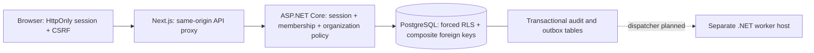

# SaveIT architecture

Status: working local foundation, 2026-10-28. [Original enterprise brief](project-brief.md) remains the scope of the product. This slice is not a production release.

## Repository inspection and choices

The target repository started at `de89d01` with a short README and Visual Studio `.gitignore`. There were no application projects, tests, migrations, or instruction files. The existing ignore rules were retained and extended. Next.js subsequently generated `apps/web/AGENTS.md`; it is retained. Docker was installed but its daemon was unavailable, so the documented local path uses real, loopback-only PostgreSQL binaries through a pinned development dependency. This does not substitute an in-memory database.

Use .NET 10 LTS, ASP.NET Core, EF Core 10, PostgreSQL 18, Next.js 16 App Router, React 19, and strict TypeScript. Versions are pinned in `global.json`, project references, npm/NuGet lockfiles, and the local tool manifest. The installed SDK is 10.0.401; managed EF dependencies are 10.0.14. Update the SDK/runtime to current servicing patches before any release. The [Microsoft support policy](https://dotnet.microsoft.com/en-us/platform/support/policy) and [Next.js documentation](https://nextjs.org/docs/app/getting-started/installation) were checked on 2026-10-28.

## Runtime and boundaries

`apps/web` owns interaction and presentation. It never decides authorization. It uses TypeScript schemas generated from the API's OpenAPI document in `contracts/`. The API owns the core platform, basic documentation, and initial policy/audit code. Keep explicit interfaces and module-owned data as modules grow; the first small application shares a DbContext to commit core changes and audit/outbox atomically. No worker may query another module's tables ad hoc in the future.

`services/workers` is a runnable empty host, **not** a working dispatcher or connector. `infra/terraform` is a validated structure for deployment decisions, with no purchased or deployable cloud resources. PostgreSQL is the only active external service. Redis, OpenSearch, OpenFGA, Temporal, private S3, KMS, enterprise identity, and OpenTelemetry are planned, not simulated.

The first UI uses a small original stylesheet and native accessible controls. Tailwind and a larger reusable component system are deferred UI implementation work; no commercial editor/component entitlement is assumed.

## Tenant and authorization boundary

A subscribing tenant is distinct from its managed organizations. The encrypted/signed ASP.NET cookie carries a server-selected membership, tenant, and subject. Each protected request opens a PostgreSQL transaction, applies transaction-local `app.tenant_id`, and checks that the membership is still active. Every organization endpoint looks up a current organization grant. No tenant header, payload field, organization selection, or browser state grants authority.

There are two scoped roles: Viewer reads assets and document bodies/revisions; Editor additionally creates assets, creates/revises documents, and reads organization audit history. Unknown or inaccessible organizations and records return 404; forbidden actions inside a readable organization return 403. Revoked membership returns 401. No permission caching or search index exists; revocation is checked against PostgreSQL on the next request. See [ADR 002](adr/002-authorization-consistency.md) for concurrency limits.

All nine tenant tables have forced PostgreSQL RLS. The API role is neither a table owner, superuser, nor BYPASSRLS role; startup refuses a privileged role. EF tenant filters and write guards add application defenses. Tenant-qualified foreign keys prevent a document from linking to an asset in a different tenant **or managed organization**. The application role cannot alter identity grants, update/delete revisions, or update/delete audit entries. Database owners remain privileged; this is not an immutable archive. See [PostgreSQL RLS semantics](https://www.postgresql.org/docs/current/ddl-rowsecurity.html).

## Implemented model

| Record | Scope and constraints |
| --- | --- |
| Tenant | Subscribing account; RLS on Id |
| Membership | Tenant + external subject; active flag; unique tenant/subject |
| Organization | Managed entity; alternate key (TenantId, Id) |
| OrganizationGrant | Tenant/membership/organization key; checked Viewer/Editor role |
| Asset | Tenant/organization/Id key; bounded name/type; immutable created timestamp |
| Document | Tenant/organization/asset FK; title, plain text, optimistic integer version |
| DocumentRevision | Append-only tenant/document/version key; actor, title/content snapshot |
| AuditEvent | Tenant, organization, actor, target, action, timestamp, outcome, correlation; no content |
| OutboxEvent | Tenant, organization, opaque target, type, schema version, timestamp, delivery marker |

The remaining required entities are explicitly planned: Location, User/identity directory, Group, AssetType and typed custom-field schema, AssetRelationship, Attachment, Checklist, CredentialReference, PermissionGrant with inheritance/denies, IntegrationConnection, SyncCheckpoint, WorkflowDefinition, WorkflowRun. Membership subjects are the development identity adapter; this does not implement a user lifecycle system.

## Transactions, concurrency, and contracts

Endpoint filters commit before executing the HTTP result. Exceptions, stale versions, and failed writes roll back the request transaction. A business write, its revision, its audit event, and its outbox event share a single atomic commit. Document body/revision reads also require a successful audit insert. Revision updates use an expected version in both API validation and the EF update predicate. A conflict returns 409 without overwriting user text or inserting a successful change event.

Assets/documents/revisions/audit use cursor pages of at most 50 rows. Organization selection is currently capped at 100 grants; a paginated organization picker is required for larger accounts. Lists return metadata only; document bodies are loaded through an audited endpoint. Revisions are append-only, not restorable yet. No delete, export, share, custom fields, secrets, HTML rendering, or uploads are exposed.

Events are schema-v1 **invalidation metadata**, without document/secret contents. They remain durably pending: there is no delivery-success claim. A future dispatcher must define per-target ordering, deduplication by event Id, retries with jitter, dead-letter/replay/operator recovery, and idempotent consumers. Rehydrate only through an authorized tenant-aware module interface; invalidations do not reconstruct intermediate document versions. Temporal never implies exactly-once external effects.

## UX, operations, and assumptions

Persistent organization selection, bounded inventory, linked plain-text documents, conflict recovery, revision inspection, role labels, and audit history are implemented. Forms use labels, native controls, focus outlines, status/error regions, and a skip link. Responsive/keyboard and automated accessibility checks are part of browser tests. These checks do not constitute a complete WCAG audit or screen-reader/user research evidence.

Local sign-in requires both the Development environment and explicit identity opt-in. It has synthetic profiles, a two-hour HttpOnly SameSite=Strict cookie, antiforgery tokens on all mutations including login/logout, and login rate limits. Production startup fails closed while enterprise identity is unconfigured. The local Next proxy binds only loopback; no browser tokens are stored in localStorage. CSP currently permits inline framework scripts/styles; nonce-based CSP and real HTTPS/proxy/session-key operations remain release work.

The default deployment direction is AWS regional cells on ECS/Fargate with private RDS, OpenSearch, Redis, S3, KMS, least-privilege identities, and Terraform. No active-active writes. Dedicated deployment/residency options stay on the roadmap. Self-hosting, licensing, budget, regions, regulated data, support commitments, and external identity-provider selection remain unresolved.

Targets remain proposals: API p95 <300 ms, search p95 <700 ms, usable main screen <2 s on a defined client/network, availability 99.95%, regional RPO <=15 min and RTO <=4 h. No load, availability, backup restore, or disaster recovery results are claimed. Record tenant sizes, concurrency, cold/warm state, region, and measurement boundaries when testing them.
