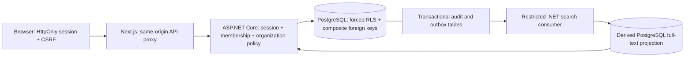

# SaveIT architecture

Status: working local core and unconfigured Okta adapter, 2026-10-31. [Original enterprise brief](project-brief.md) remains the scope of the product. This is not a production release.

## Repository inspection and choices

The target repository started at `de89d01` with a short README and Visual Studio `.gitignore`. There were no application projects, tests, migrations, or instruction files. The existing ignore rules were retained and extended. Next.js subsequently generated `apps/web/AGENTS.md`; it is retained. Docker was installed but its daemon was unavailable, so the documented local path uses real, loopback-only PostgreSQL binaries through a pinned development dependency. This does not substitute an in-memory database.

Use .NET 10 LTS, ASP.NET Core, EF Core 10, PostgreSQL 18, Next.js 16 App Router, React 19, and strict TypeScript. Versions are pinned in `global.json`, project references, npm/NuGet lockfiles, and the local tool manifest. The installed SDK is 10.0.401; managed EF dependencies are 10.0.14. Update the SDK/runtime to current servicing patches before any release. The [Microsoft support policy](https://dotnet.microsoft.com/en-us/platform/support/policy) and [Next.js documentation](https://nextjs.org/docs/app/getting-started/installation) were checked on 2026-10-28.

## Runtime and boundaries

`apps/web` owns interaction and presentation. It never decides authorization. It uses TypeScript schemas generated from the API's OpenAPI document in `contracts/`. The API owns the core platform, basic documentation, and initial policy/audit code. Keep explicit interfaces and module-owned data as modules grow; the first small application shares a DbContext to commit core changes and audit/outbox atomically. No worker may query another module's tables ad hoc in the future.

`services/search` owns a rebuildable PostgreSQL full-text projection and its query/consumer implementation; `services/workers` runs the real tenant-scoped consumer. Core exposes a security-invoker `CoreSearchSources` read view with underlying RLS. The worker has no write privileges to core/outbox/audit/identity tables. `infra/terraform` is a validated structure for deployment decisions, with no purchased or deployable cloud resources. PostgreSQL is the only active external service. Redis, OpenSearch, OpenFGA, Temporal, private S3, KMS and OpenTelemetry remain planned. The Okta adapter is implemented but unconfigured and live-unverified (ADR 010). See [ADR 006](adr/006-search-and-delivery.md) for the intentional first-search implementation choice.

The first UI uses a small original stylesheet and native accessible controls. Tailwind and a larger reusable component system are deferred UI implementation work; no commercial editor/component entitlement is assumed.

## Tenant and authorization boundary

A subscribing tenant is distinct from its managed organizations. The encrypted/signed ASP.NET cookie carries a server-selected membership, tenant, and subject. Each protected request opens a PostgreSQL transaction, applies transaction-local `app.tenant_id`, and checks that the membership is still active. Every organization endpoint looks up a current organization grant. No tenant header, payload field, organization selection, or browser state grants authority.

There are two scoped roles: Viewer reads assets/history/relationships, locations/contacts, document bodies/revisions/comparisons and authorized search; Editor additionally creates/revises/restores assets/documents, edits/archives/reactivates directory records, creates/removes links and reads organization audit history. Unknown or inaccessible organizations and records return 404; forbidden actions inside a readable organization return 403. Revoked membership returns 401. No permission cache exists. Search joins live membership/grants and current exact source state before returning any title, plain-text preview or cursor. Stale/mismatched projections are excluded; committed revocation takes effect on the next request without waiting for indexing. Asset relationships never grant access. See [ADR 002](adr/002-authorization-consistency.md) for in-flight concurrency limits.

All twenty-eight protected tenant tables (25 core plus three access protocol/control tables) have forced PostgreSQL RLS. API and worker roles are neither table owners, superusers, nor BYPASSRLS roles; startup rejects ownership and reachable privileged/owner roles. Worker validation also rejects core table/column writes reachable through NOINHERIT membership. EF tenant filters and write guards add application defenses. Tenant-qualified foreign keys prevent documents/projections, asset placements/history and either relationship endpoint from crossing tenant **or managed organization** boundaries. The application role cannot alter identity grants, update/delete revisions/audit, rewrite relationship endpoints/type/creation metadata, physically delete directory records/links, or directly write projections/consumer receipts. Worker tenants come from an explicit operator-configured allowlist; each job transaction sets its own tenant context. Database owners remain privileged; this is not an immutable archive. See [PostgreSQL RLS semantics](https://www.postgresql.org/docs/18/ddl-rowsecurity.html).

## Implemented model

| Record | Scope and constraints |
| --- | --- |
| Tenant | Subscribing account; RLS on Id |
| Membership | Tenant + canonical subject; active flag; separately provisioned CanManageOrganizations capability; nullable exact external issuer/subject pair with scoped uniqueness |
| Organization | Managed entity; alternate key (TenantId, Id), bounded name, optimistic version/update time |
| OrganizationRevision | Immutable tenant/organization/version snapshot of exact name, actor/time and fixed origin; API SELECT only, checked-function writes |
| OrganizationGrant | Tenant/membership/organization key; checked Viewer/Editor role |
| Location / Contact | Tenant/organization-qualified IDs; bounded plain-text fields, optimistic versions, retained archival |
| LocationRevision / ContactRevision | Append-only tenant/organization/record/version key; exact fields/lifecycle, actor/time and scoped source/reason provenance |
| Asset | Tenant/organization/Id key; bounded name/type, optional scoped location; optimistic version, created/updated timestamps |
| AssetRevision | Append-only tenant/asset/version key; organization, exact name/type/location ID and nullable historical name, actor/time, source/reason provenance with scoped FKs/check |
| AssetRelationship | Two tenant/organization-qualified asset FKs; directed type, active uniqueness, optimistic lifecycle version, creation/removal actor/time; restricted update columns |
| DocumentFolder | Tenant/organization-qualified nullable parent, bounded name and optimistic version; serialized eight-level/1,000-node hierarchy |
| DocumentPlacement | Scoped document/folder FKs; nullable unfiled location, independent optimistic version; filing preserves content versions/history |
| DocumentTemplate / DocumentTemplateRevision | Scoped metadata head and immutable exact plain-text/lifecycle snapshots; per-publication deferred integrity checks |
| DocumentTemplateOrigin | Append-only scoped starter revision pin and document initial-revision FK; independent of content/placement |
| Document | Tenant/organization/asset FK; title, plain text, optimistic integer version |
| DocumentRevision | Append-only tenant/document/version key; actor, exact title/content snapshot; nullable restore source/reason with composite FK/check |
| AuditEvent | Tenant, organization, actor, target, action, timestamp, outcome, correlation; optional numeric source/target versions; no content/reason |
| OutboxEvent | Tenant, organization, opaque target, type, schema version, timestamp, delivery marker |
| SearchEntry | Derived tenant/type/target key, scoped asset FK, version, current source snapshot, generated GIN-indexed full-text vector |
| SearchDelivery | Tenant/event FK, attempt/backoff, completion/dead-letter timestamps, safe error code; search-v1 consumer only |

The remaining required entities are explicitly planned: User/identity directory, Group, Attachment, Checklist, CredentialReference, PermissionGrant with inheritance/denies, IntegrationConnection, SyncCheckpoint, WorkflowDefinition, WorkflowRun. Memberships support development identity or preprovisioned Okta subject mappings; this does not implement a user lifecycle system. Basic asset links are implemented; richer relationship types/graphs and relationship-based authorization remain separate future work.

## Transactions, concurrency, and contracts

Endpoint filters commit before executing the HTTP result. Exceptions, stale versions, and failed writes roll back the request transaction. A business write, its revision, its audit event, and its outbox event share a single atomic commit. Document body/revision reads also require a successful audit insert. Revision updates use an expected version in both API validation and the EF update predicate. A conflict returns 409 without overwriting user text or inserting a successful change event.

Organizations/assets/directories/documents/revisions/audit use cursor pages of at most 50 rows. Organization pages use protected tenant/membership-bound name/UUID cursors and current grants before labels or continuation; authorized lookup by ID supports search navigation beyond loaded choices. All organization list/read metadata is audited before serialization. Document lists return metadata only; bodies are loaded through an audited endpoint. No hard delete, export, share, secrets, HTML rendering, or uploads are exposed.

Limited organization administration uses a live, separately provisioned capability. Creation gives only its creator an Editor grant to a server-generated brand-new organization; renaming additionally requires an existing Editor grant. Checked SECURITY DEFINER functions validate and lock the current tenant/membership/capability and rename grant, enforce plain creation/expected versions, and share the request's atomic audit/outbox transaction. No direct API organization/grant writes are allowed. The worker guard rejects execution of either function through direct/PUBLIC/reachable roles. No existing permission/grant/capability administration or revocation endpoint is exposed. Synthetic seed restores Alice/Bob's local capability; real provisioning and production definer/forced-RLS operation remain externally controlled/unverified. See [ADR 012](adr/012-organization-administration.md).

Locations/contacts support audited create/read/edit/archive/reactivate with optimistic versions. Assets support versioned metadata changes, active scoped placement, audited history and confirmed restore as a new version; existing archived placements remain readable. Revisions retain exact name/type/location and restoration provenance, with no app update/delete permission. Migration backfill establishes an initial snapshot, not fabricated earlier history. See [ADR 009](adr/009-directory-and-asset-history.md).

Document restoration appends a new revision copied from an earlier snapshot, preserving all history. Expected-version concurrency, current Editor access and CSRF apply again at submission; revision/audit/outbox commit atomically. Restore source/reason are confidential revision metadata; audit records only numeric source/target versions. A composite self-reference and check enforce provenance. Comparison reads are audited and return at most 200 numbered plain-text rows, using bounded LCS or faithful replacement blocks for large edits. See [ADR 007](adr/007-document-recovery.md). This is not deletion recovery or backup restoration.

Directed DependsOn/Contains asset links stay inside one organization. Lists join both currently scoped endpoint records, audit reads and return at most 50 active links. Editor creation/removal commits the relationship/audit/outbox together; active uniqueness and lifecycle version predicates handle duplicate/remove races. Removal retains its row and both assets/documents; a later recreation has a new ID. Search-v1 explicitly acknowledges known schema-v1 link events without projection changes and retains separate receipts. The worker has no relationship-table access, and its startup guard rejects column-level core writes too. See [ADR 008](adr/008-asset-relationships.md); custom types, cross-organization links, cycle enforcement and graph navigation remain planned.

Events are schema-v1 **invalidation metadata**, without document/secret contents. A restricted fixed trigger atomically enqueues a pending search receipt with the outbox write; enqueue failure rolls back the business transaction. The consumer selects due receipts using a matching partial index, avoiding retained completed history and timestamp checkpoint gaps. It rehydrates latest source through the tenant-aware core read contract; invalidations do not reconstruct intermediate versions. Projection and completion receipt commit together. Per-tenant advisory locks serialize consumers/rebuilds, idempotent rehydration and version guards tolerate duplicates/reordering, and failed attempts use bounded exponential backoff/jitter before dead-letter. Trusted CLI commands rebuild or reset scoped receipts; the worker cannot delete receipts. Global `OutboxEvents.DeliveredAt` stays untouched. Generic external dispatch/Temporal workflows remain unimplemented. See [ADR 011](adr/011-transactional-search-queue.md), including production definer/backfill prerequisites.

Search returns at most 25 authorized records with query/principal/scope-bound keyset cursors. Scope/type filters and per-document ranking precede pagination. Current authoritative data supplies all returned labels/previews; stale or inaccessible candidates do not create counts/cursors. Every returned result is audited atomically, without search text/content in events. Projection/source outages return unavailable; there is no stale-cache or direct-query fallback. Bodies remain plain text. Full-text matches complete words, not fuzzy/prefix suggestions, facets, total counts or files/vault values.

## UX, operations, and assumptions

Persistent organization selection, bounded inventory, linked plain-text documents, conflict recovery, revision inspection/comparison, confirmed restoration with reasons, role labels, audit history, and permission-aware search are implemented. Search opens current records through authorized endpoints, clears stale results on scope changes/failures, and reports asynchronous indexing limits. Forms use labels, native controls/dialogs, focus outlines, status/error regions, and a skip link. Responsive/keyboard and automated accessibility checks are part of browser tests. These checks do not constitute a complete WCAG audit or screen-reader/user research evidence.

Local sign-in requires both the Development environment and explicit identity opt-in. It has synthetic profiles, a two-hour HttpOnly SameSite=Strict cookie, antiforgery tokens on mutations including login/logout, and login rate limits. Okta uses code/PKCE, verified issuer/subject mapped to a preprovisioned server-selected tenant, Secure HttpOnly SameSite=Lax cookies and optional exact acr validation; it ignores token tenant/role claims. Nondevelopment startup fails closed without Okta settings and a certificate-protected persisted key ring. No live Okta/MFA or operational key recovery verification exists. The local Next proxy binds only loopback; no tokens are stored in localStorage. ADR 022 adds dynamically rendered nonce-based script CSP, runtime origins, public Host checks and bounded trusted forwarded-protocol handling; inline styles remain permitted. Operated HTTPS/proxy/session-key lifecycle still requires staging evidence. See [ADR 010](adr/010-okta-identity.md).

The default deployment direction is AWS regional cells on ECS/Fargate with private RDS, OpenSearch, Redis, S3, KMS, least-privilege identities, and Terraform. No active-active writes. Dedicated deployment/residency options stay on the roadmap. The user chose Okta and has no nonproduction AWS/integration account yet. Self-hosting, licensing, budget, regions, regulated data and support commitments remain unresolved.

Targets remain proposals: API p95 <300 ms, search p95 <700 ms, usable main screen <2 s on a defined client/network, availability 99.95%, regional RPO <=15 min and RTO <=4 h. A same-cluster synthetic logical database/key-ring recovery drill is verified under ADR 023. No load, availability, managed point-in-time restore, regional disaster recovery or achieved RPO/RTO results are claimed. Record tenant sizes, concurrency, cold/warm state, region, and measurement boundaries when testing them.

## Versioned typed assets

ADR 013 adds organization-scoped `AssetTypes`/immutable `AssetTypeRevisions`, pinned asset/history references and bounded JSONB fields. PostgreSQL v1 invoker validators, definition CHECKs, asset/history triggers, qualified FKs and forced RLS protect the typed-asset boundary. Publishing never rewrites assets; upgrades and restoration require explicit validated values and expected asset versions. Current metadata edits retain fields; exact historical restoration retains the old schema. Archived pins remain readable/editable, while new or different bindings require an active template.

Schema/value/default content is returned only by audited field/definition/history reads. Asset and relationship metadata DTOs carry references only. Type events are schema-v1 metadata acknowledgements. Worker asset SELECT is column-restricted; type/history reads are denied and startup rejects reachable content grants. Custom fields and definitions are excluded from search. UTF-8 databases are required; request and JSON limits are described in ADR 013. Richer configuration/schema migrations, field search and cross-organization templates remain unfinished.

## Directory revision history and recovery

ADR 015 adds `LocationRevisions`/`ContactRevisions`, bringing the protected table total to 19. Creation/edit/archive/reactivate and confirmed restore append exact snapshots in the current-record/audit/outbox/queue transaction. Backfill captures only the actual current version/time/fields as `migration`; earlier missing history remains unavailable. Scoped parent/source FKs, paired provenance checks, forced RLS and app SELECT/INSERT-only grants protect both tables. Every metadata-only 50-row page and exact snapshot read requires current membership/grants and durable read audit. Restoration copies exact fields and archived state as a new version with current Editor/CSRF/expected-version checks. Linked assets keep their identity/placement.

Worker guards reject new-table ownership, reachable core/column writes and directory current/history reads. Exact schema-v1 directory restoration events are acknowledged without indexing fields; unknown events/schemas still dead-letter. Browser review/confirmation preserves reasons across conflicts/failed reloads, clears failed historical output and coordinates global busy/cancellation. Directory merges, deletion/retention and backup restoration remain separate work. ADR 016 adds historical asset-location name pins below; ADR 017 adds bounded directory comparison.

## Asset revision comparison

ADR 014 adds a read-only comparison endpoint over at most two scoped immutable asset snapshots and two pinned schema revisions. The current asset query selects its version only. With ADR 016's fifth metadata row and up to 40 union field keys, comparison produces at most 45 deterministic rows, filtered before 20-row offset pages. Every page requires current membership/organization authority and durable numeric-only audit; missing historical schema/source or failed audit withholds results. Exact historical definitions supply names/rules/defaults; values distinguish absent, false, zero and empty text, without applying defaults. Restore reasons are not selected. Comparison creates no business writes/outbox/search events, and restoration retains its independent Editor/concurrency checks.

## Historical asset location names

ADR 016 adds a nullable bounded name to immutable asset snapshots. Ordinary writes capture one current scoped name, including retained archived placements, and fail closed if that source cannot be read. Restore copies the source name/NULL exactly, leaving the current directory unchanged. The additive migration invents no earlier names. History/confirmation/comparison distinguish unassigned from unavailable and render literal saved labels; comparison never substitutes current directory data. Audit/outbox/search carry no names, worker history reads stay denied and the existing forced-RLS table boundaries remain. Capture reflects its READ COMMITTED lookup, not serialized ordering with concurrent directory changes.

## Directory revision comparison

ADR 017 adds current-authorized, audited comparison of two immutable location/contact snapshots, projecting no restore reason and only the current version from the head. Four location/six contact scalar fields include exact strings, explicit empty text and boolean lifecycle; line-ending-only changes are disclosed without rewriting stored text. Changes-only filtering precedes four-row pages and each page commits numeric-only read audit before serialization. Source/audit failure withholds all comparison output. The literal responsive browser clears stale results and coordinates owned requests/global busy; comparison versions never update restore authority. No schema, grant, worker, event or dependency changes; the existing forced-RLS table boundaries remain.

## Organization name history

ADR 018 adds the twentieth forced-RLS tenant table, `OrganizationRevisions`, with a scoped parent FK and API SELECT-only grants. Existing checked create/rename functions derive actor from locked membership, fixed origin and exact persisted head fields; history/current/grant/audit/outbox/queue commit atomically. Migration captures only the actual current version/name/time, and fresh synthetic seeds record Seed origin. Existing seed reruns invent no history; Down restores predecessor functions before dropping the table. Current Viewers/Editors read audited newest-first 50-row pages after live authority and current organization checks; source/audit failure returns no names/cursor. Worker guards deny history ownership, reachable writes and any column read. Browser requests cancel/clear safely across context changes and retry from the head. Organization restoration, broader lifecycle/permissions and production function/backfill authority remain separate work. See [ADR 018](adr/018-organization-name-history.md).

## Document folders and independent placement

ADR 019 adds DocumentFolders/DocumentPlacements, bringing the total to 22 forced-RLS tenant tables. Current organization roles remain the sole folder authority. Scoped parent/document/folder FKs, immutable keys and column-limited API updates protect adjacency and assignment. Folder writes take the same tenant/org advisory lock in a separate API statement and VOLATILE invoker trigger, then validate full ancestor/subtree depth and the 1,000-folder/eight-level limits under READ COMMITTED. Other mutation isolation levels are rejected. Legacy documents start unfiled at placement version zero without invented rows; actual moves advance a separate placement version, preserving content/history/asset/search versions and surviving restoration. Writes/audit/outbox/queue remain atomic.

Audited 50-row child/document pages and at-most-eight-node paths use current sources; metadata never selects body content. Concrete-folder reads filter scoped placements before joining documents, supported by the composite index; root/unfiled scan scaling remains unmeasured. Worker guards reject new-table ownership, reachable writes and any column reads. Only known schema-v1 folder/filing metadata events receive no-op receipts; no folder names/paths enter search/events. Literal browser navigation/destination selection clears failed reads, owns busy/cancellation and context denial, and retains conflict choices through failed reloads. A successful audited reload shows current saved state before explicit retry. Partial folder ACLs, folder history/lifecycle, rich content/templates, bulk hierarchy operations and production assurance remain unfinished. See [ADR 019](adr/019-document-folders.md).

## Reviewed document starters

ADR 020 adds three forced-RLS tables, bringing the total to 25. Metadata-only template heads use expected versions and column-limited writes; immutable exact revisions and append-only document origins use scoped FKs. Deferred checks require every head publication to have its own matching snapshot. Publishing saves the head before inserting its snapshot, inside the existing outer transaction with audit/outbox/queue. Creation locks the scoped current head FOR SHARE before active/version checks, then atomically creates the normal document/initial revision, origin and events. The pin describes a reviewed editable starter; later edits/restore/filing preserve it and placement. Existing documents gain no fabricated provenance.

Audited metadata/history pages return at most 50 rows; exact bodies and origins require separate live-authorized audited reads. Read failure withholds data rather than inventing absent provenance. Worker reads/writes/ownership are denied for all three tables; only schema-v1 template metadata events are no-ops. Reviewed documents use normal Document.Created indexing of actual final text. Native browser review retains drafts/409 barriers, clears stale current-state output, coordinates owned requests and restores history focus after loading. Rich content, executable variables, template restore/reapply, cross-organization and bulk work remain unfinished.

## Document-template comparison

[ADR 021](adr/021-document-template-comparison.md) adds a read-only comparison using the same 25 tenant tables. Current live access and a version-only head projection precede at most two scoped immutable snapshots. Historical names/titles/lifecycle are exact; the shared bounded line diff explains line endings without changing storage. Changes-only filtering precedes 200-line pages; each page requires a numeric-version-only audit and successful outer commit before any result is returned. Source/current/audit failure withholds summaries, lines, counts and cursors. No outbox event, search privilege, content mutation, origin or placement change is introduced. The browser clears stale results, owns cancellation/global busy, restores result/error focus after unlocking and returns focus on Close/Escape. Observed current version is informational and never updates publication/creation authority. Template restore/reapply and enterprise readiness remain separate work.

## Separate deployment and packaged runtime

ADR 022 isolates seed-free forward migration and insert-only initial tenant provisioning in a dedicated deployment executable. The fixed non-login owner has no elevated attributes and is unreachable from app/worker roles; owner-only RLS policies permit real multi-tenant backfills while forced tenant policies remain. Runtime public namespace, verified remote TLS, all-table forced-RLS/release and reachable schema-CREATE guards fail closed. Nonroot images package web/API/worker/deployment; runtime origins, trusted protocol, dynamic script nonce CSP/no-store and bounded dependency/progress readiness are tested in synthetic packaged CI. Provider-aware retry cleanup supports one-slot pools and broken/deferred-failure transactions. See the deployment guide and progress for exact evidence and key/fixture limits. Managed deployment, live/delegated access operations, managed recovery and the complete enterprise roadmap remain separate work.

## Restricted access operations and response completion

ADR 025 adds three forced-RLS operational/control tables (28 protected total). Exact mapped-member onboarding, active state, Viewer/Editor grants and organization-administration capability changes use a separate NOLOGIN operator role through checked private CLI functions. Expected versions, qualified sources and membership/grant/audit/control-event writes share one transaction. The control outbox is separate from search; generic delivery remains unimplemented. Automatic creator grants advance the same access version. Runtime/worker cannot read/write protocol tables directly or reach operator role/functions, including column/PUBLIC/NOINHERIT paths.

Both sign-in adapters seal a live session epoch into cookies and register before issuing output. Every protected request registers a durable pending response under a short shared member gate; business/read audits retain their own existing atomic transactions. Operator changes acquire the exclusive gate before core row locks, drain old pending responses, mutate and acknowledge commit. Only server OnCompleted closes a record, with separate bounded completion capacity/idempotent retries. Fresh VOLATILE/READ COMMITTED observations follow advisory waits. Stalled/orphan records time out with access unchanged; no age/force-close bypass exists. API completion cannot recall proxy/network/client buffers. Recovery that might lose committed records must fence old instances before acknowledging changes. Managed fencing, human operator identity/credential lifecycle, SCIM/delegated UI and actual live-provider/scale evidence remain gates; see progress for executed tests.

## Source and image release checks

ADR 026 defines pinned full-reachable-history Gitleaks with explicit upstream exclusions and a runtime detection/redaction canary, CodeQL security-extended threshold gates, and native/CycloneDX inventories tied to the same four verified packaged images. Actual execution status is in progress. Local configuration IDs and SBOM hashes are unsigned bookkeeping; registry promotion, signatures, vulnerability/license policy and branch/environment enforcement remain unfinished. See [source security](source-security.md).

ADR 027 extends image inventory with pinned Grype/fresh public database checks and a patched minimal Node runtime on Ubuntu 24.04 chiseled runtime-deps. Full-image and packaged execution are required; base-only scans do not establish application results. High/critical/unknown matches block, lower findings remain visible. See source-security/progress for scope, inherited matcher defaults and execution evidence.

## Isolated network/database definition

ADR 028 adds a separate unapplied cell-foundation root: four private subnets/two AZs, local-only routes, empty default SG and three designated process-to-PostgreSQL paths, rotating protected storage key and RDS-managed bootstrap credentials. All variables are explicit and mocked plans require no AWS credentials. This is partial infrastructure, not a runnable application cell or managed compatibility/recovery evidence. Account-side drift and actual role/CA/KMS/restore verification, compute/ingress/restricted egress, workload keys/secrets and operations remain gates.
