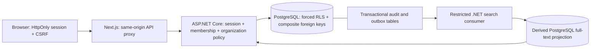

# SaveIT architecture

Status: working local foundation, 2026-10-28. [Original enterprise brief](project-brief.md) remains the scope of the product. This slice is not a production release.

## Repository inspection and choices

The target repository started at `de89d01` with a short README and Visual Studio `.gitignore`. There were no application projects, tests, migrations, or instruction files. The existing ignore rules were retained and extended. Next.js subsequently generated `apps/web/AGENTS.md`; it is retained. Docker was installed but its daemon was unavailable, so the documented local path uses real, loopback-only PostgreSQL binaries through a pinned development dependency. This does not substitute an in-memory database.

Use .NET 10 LTS, ASP.NET Core, EF Core 10, PostgreSQL 18, Next.js 16 App Router, React 19, and strict TypeScript. Versions are pinned in `global.json`, project references, npm/NuGet lockfiles, and the local tool manifest. The installed SDK is 10.0.401; managed EF dependencies are 10.0.14. Update the SDK/runtime to current servicing patches before any release. The [Microsoft support policy](https://dotnet.microsoft.com/en-us/platform/support/policy) and [Next.js documentation](https://nextjs.org/docs/app/getting-started/installation) were checked on 2026-10-28.

## Runtime and boundaries

`apps/web` owns interaction and presentation. It never decides authorization. It uses TypeScript schemas generated from the API's OpenAPI document in `contracts/`. The API owns the core platform, basic documentation, and initial policy/audit code. Keep explicit interfaces and module-owned data as modules grow; the first small application shares a DbContext to commit core changes and audit/outbox atomically. No worker may query another module's tables ad hoc in the future.

`services/search` owns a rebuildable PostgreSQL full-text projection and its query/consumer implementation; `services/workers` runs the real tenant-scoped consumer. Core exposes a security-invoker `CoreSearchSources` read view with underlying RLS. The worker has no write privileges to core/outbox/audit/identity tables. `infra/terraform` is a validated structure for deployment decisions, with no purchased or deployable cloud resources. PostgreSQL is the only active external service. Redis, OpenSearch, OpenFGA, Temporal, private S3, KMS, enterprise identity, and OpenTelemetry remain planned, not simulated. See [ADR 006](adr/006-search-and-delivery.md) for the intentional first-search implementation choice.

The first UI uses a small original stylesheet and native accessible controls. Tailwind and a larger reusable component system are deferred UI implementation work; no commercial editor/component entitlement is assumed.

## Tenant and authorization boundary

A subscribing tenant is distinct from its managed organizations. The encrypted/signed ASP.NET cookie carries a server-selected membership, tenant, and subject. Each protected request opens a PostgreSQL transaction, applies transaction-local `app.tenant_id`, and checks that the membership is still active. Every organization endpoint looks up a current organization grant. No tenant header, payload field, organization selection, or browser state grants authority.

There are two scoped roles: Viewer reads assets, document bodies/revisions/comparisons and authorized search; Editor additionally creates assets, creates/revises/restores documents, and reads organization audit history. Unknown or inaccessible organizations and records return 404; forbidden actions inside a readable organization return 403. Revoked membership returns 401. No permission cache exists. Search joins live membership/grants and current exact source state before returning any title, plain-text preview or cursor. Stale/mismatched projections are excluded; committed revocation takes effect on the next request without waiting for indexing. See [ADR 002](adr/002-authorization-consistency.md) for in-flight concurrency limits.

All eleven tenant tables have forced PostgreSQL RLS. API and worker roles are neither table owners, superusers, nor BYPASSRLS roles; startup refuses privileged roles. EF tenant filters and write guards add application defenses. Tenant-qualified foreign keys prevent documents/projections from linking to assets in a different tenant **or managed organization**. The application role cannot alter identity grants, update/delete revisions/audit, or write projections/consumer receipts. Worker tenants come from an explicit operator-configured allowlist; each job transaction sets its own tenant context. Database owners remain privileged; this is not an immutable archive. See [PostgreSQL RLS semantics](https://www.postgresql.org/docs/current/ddl-rowsecurity.html).

## Implemented model

| Record | Scope and constraints |
| --- | --- |
| Tenant | Subscribing account; RLS on Id |
| Membership | Tenant + external subject; active flag; unique tenant/subject |
| Organization | Managed entity; alternate key (TenantId, Id) |
| OrganizationGrant | Tenant/membership/organization key; checked Viewer/Editor role |
| Asset | Tenant/organization/Id key; bounded name/type; immutable created timestamp |
| Document | Tenant/organization/asset FK; title, plain text, optimistic integer version |
| DocumentRevision | Append-only tenant/document/version key; actor, exact title/content snapshot; nullable restore source/reason with composite FK/check |
| AuditEvent | Tenant, organization, actor, target, action, timestamp, outcome, correlation; optional numeric source/target versions; no content/reason |
| OutboxEvent | Tenant, organization, opaque target, type, schema version, timestamp, delivery marker |
| SearchEntry | Derived tenant/type/target key, scoped asset FK, version, current source snapshot, generated GIN-indexed full-text vector |
| SearchDelivery | Tenant/event FK, attempt/backoff, completion/dead-letter timestamps, safe error code; search-v1 consumer only |

The remaining required entities are explicitly planned: Location, User/identity directory, Group, AssetType and typed custom-field schema, AssetRelationship, Attachment, Checklist, CredentialReference, PermissionGrant with inheritance/denies, IntegrationConnection, SyncCheckpoint, WorkflowDefinition, WorkflowRun. Membership subjects are the development identity adapter; this does not implement a user lifecycle system.

## Transactions, concurrency, and contracts

Endpoint filters commit before executing the HTTP result. Exceptions, stale versions, and failed writes roll back the request transaction. A business write, its revision, its audit event, and its outbox event share a single atomic commit. Document body/revision reads also require a successful audit insert. Revision updates use an expected version in both API validation and the EF update predicate. A conflict returns 409 without overwriting user text or inserting a successful change event.

Assets/documents/revisions/audit use cursor pages of at most 50 rows. Organization selection is currently capped at 100 grants; a paginated organization picker is required for larger accounts. Lists return metadata only; document bodies are loaded through an audited endpoint. No delete, export, share, custom fields, secrets, HTML rendering, or uploads are exposed.

Document restoration appends a new revision copied from an earlier snapshot, preserving all history. Expected-version concurrency, current Editor access and CSRF apply again at submission; revision/audit/outbox commit atomically. Restore source/reason are confidential revision metadata; audit records only numeric source/target versions. A composite self-reference and check enforce provenance. Comparison reads are audited and return at most 200 numbered plain-text rows, using bounded LCS or faithful replacement blocks for large edits. See [ADR 007](adr/007-document-recovery.md). This is not deletion recovery or backup restoration.

Events are schema-v1 **invalidation metadata**, without document/secret contents. The actual search consumer rehydrates latest source through the tenant-aware core read contract; invalidations do not reconstruct intermediate versions. Projection and consumer receipt commit together. Per-tenant advisory locks serialize consumers/rebuilds, idempotent rehydration and version guards tolerate duplicates/reordering, and failed attempts use bounded exponential backoff/jitter before dead-letter. Trusted CLI commands rebuild or replay scoped consumer receipts. Global `OutboxEvents.DeliveredAt` stays untouched so search success cannot imply delivery to future consumers. Generic external dispatch/Temporal workflows remain unimplemented and never imply exactly-once external effects.

Search returns at most 25 authorized records with query/principal/scope-bound keyset cursors. Scope/type filters and per-document ranking precede pagination. Current authoritative data supplies all returned labels/previews; stale or inaccessible candidates do not create counts/cursors. Every returned result is audited atomically, without search text/content in events. Projection/source outages return unavailable; there is no stale-cache or direct-query fallback. Bodies remain plain text. Full-text matches complete words, not fuzzy/prefix suggestions, facets, total counts or files/vault values.

## UX, operations, and assumptions

Persistent organization selection, bounded inventory, linked plain-text documents, conflict recovery, revision inspection/comparison, confirmed restoration with reasons, role labels, audit history, and permission-aware search are implemented. Search opens current records through authorized endpoints, clears stale results on scope changes/failures, and reports asynchronous indexing limits. Forms use labels, native controls/dialogs, focus outlines, status/error regions, and a skip link. Responsive/keyboard and automated accessibility checks are part of browser tests. These checks do not constitute a complete WCAG audit or screen-reader/user research evidence.

Local sign-in requires both the Development environment and explicit identity opt-in. It has synthetic profiles, a two-hour HttpOnly SameSite=Strict cookie, antiforgery tokens on all mutations including login/logout, and login rate limits. Production startup fails closed while enterprise identity is unconfigured. The local Next proxy binds only loopback; no browser tokens are stored in localStorage. CSP currently permits inline framework scripts/styles; nonce-based CSP and real HTTPS/proxy/session-key operations remain release work.

The default deployment direction is AWS regional cells on ECS/Fargate with private RDS, OpenSearch, Redis, S3, KMS, least-privilege identities, and Terraform. No active-active writes. Dedicated deployment/residency options stay on the roadmap. Self-hosting, licensing, budget, regions, regulated data, support commitments, and external identity-provider selection remain unresolved.

Targets remain proposals: API p95 <300 ms, search p95 <700 ms, usable main screen <2 s on a defined client/network, availability 99.95%, regional RPO <=15 min and RTO <=4 h. No load, availability, backup restore, or disaster recovery results are claimed. Record tenant sizes, concurrency, cold/warm state, region, and measurement boundaries when testing them.
